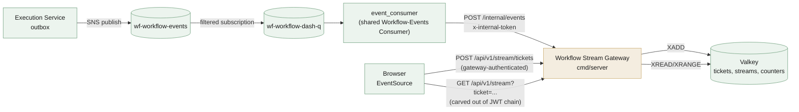

# Workflow Stream Gateway — Low-Level Design

> **In-repo copy.** This file is this repo's own copy of this document, kept content-identical to the design repo's published copy. The two are intentionally allowed to differ only on embed-vs-link mechanics — never on content.

## Workflow Engine Platform — Real-Time Dashboard Push

| Field | Value |
| --- | --- |
| Document Type | Low-Level Design (LLD) |
| Service | Workflow Stream Gateway (`workflow-stream-gateway`) |
| Supersedes | `dashboard_stream_gateway.md` (proposal, rev 1.2) — see that document's own superseded banner |
| Subsystem | Workflow Engine — real-time dashboard push |
| Version | 1.0 |
| Date | 2026-08-21 |
| Status | Approved |
| Audience | Workflow Engine team, platform/infra |
| Owner database | None — Valkey only (stateless service) |

### Revision history

| Version | Date | Notes |
| --- | --- | --- |
| 1.0 | 2026-08-21 | Initial formal LLD, superseding the `dashboard_stream_gateway.md` proposal. Carries forward every still-sound design decision from that document (ticket-authenticated SSE, per-`(tenant_id,user_id)` Valkey Stream fan-out, wire format, reconnection/backfill, isolation model) at full spec rigor (exact Valkey key schema, exact REST contracts, a companion OpenAPI file). One decision reversed after re-derivation from first principles, not carried forward as-is: event ingestion routes through the platform's existing shared Workflow-Events Consumer (`event_consumer`) via a standard `POST /internal/events` handler, rather than this service running its own dedicated SQS consumer — the proposal's stated reason for rejecting that (`dashboard_stream_gateway.md` Design Decision #2) does not survive scrutiny once its own §7 confirms this service needs no delivery-idempotency guarantee at all (§9.2 below). This removes an entire SQS/SNS-consumer component from this service's own scope. |
| 1.1 | 2026-08-24 | All 5 build phases implemented and committed (repo `workflow-stream-gateway`) — this document now describes shipped code, not a pre-build design. `workflow.instance.started` removed from the consumed-event set (§3.1), resolving this document's own previously-flagged routing/spec contradiction by siding with `execution_service`'s `asyncapi.yaml`. Flagged, not resolved: whether this service's generic event relay is sufficient for business-service-owned UI surfaces, or whether such services need their own push channel (Appendix B). |
| 1.2 | 2026-08-24 | Tenant-wide/per-department broadcast (§6) implemented and committed, superseding this document's own "no tenant-wide or role-based broadcast mode exists today" position (originally carried from `dashboard_stream_gateway.md`'s identically-unresolved Appendix B item). Two tiers, not an admin-only bypass: `tenant_admin`/`tenant_owner` get every known event tenant-wide; any role held in a department gets that department's task-scoped events. Required first fixing a genuine, independent pre-existing bug in `execution_service` (`x-departments`' `:role` half was never parsed before comparison, so department-scoped visibility silently never worked) — landed as its own fix in that repo, not folded into this service's own change. Backfill remains personal-tier-only (§8); the broadcast tiers' own lack of backfill is a new, deliberate limitation, not an oversight. |
| 1.3 | 2026-08-24 | Resolves this document's own rev 1.1-flagged open item: whether the generic event relay is sufficient for business-service-owned UI surfaces. Workflow's own UI (configuring workflows, viewing graphs) and Tender's UI are distinct surfaces by design — this service relays generic facts, and each consuming business service (Tender included) renders its own UI from them. No bespoke per-consumer channel needed (Appendix B). |
| 1.4 | 2026-08-24 | Reverses rev 1.2's "backfill remains personal-tier-only" limitation: the SSE `id:` line is now a compound cursor (§8, Appendix A Decision 16, superseding Decision 15), carrying a resume position per stream key a connection tails. A reconnecting `tenant_admin`/department-role connection now backfills its broadcast tier(s) too, not just its personal stream; any one tier's retention window being exceeded still resyncs the whole connection rather than partially replaying. Implemented and committed, not just designed. |

---

## Table of Contents

1. [Overview & Scope](#1-overview--scope)
2. [Architecture](#2-architecture)
3. [Inbound Event Contract](#3-inbound-event-contract)
4. [Valkey Key Schema](#4-valkey-key-schema)
5. [REST API](#5-rest-api)
6. [Fan-Out Routing](#6-fan-out-routing)
7. [Wire Format](#7-wire-format)
8. [Reconnection & Backfill](#8-reconnection--backfill)
9. [Security & Isolation](#9-security--isolation)
10. [Deployment](#10-deployment)
11. [Observability](#11-observability)
12. [Configuration](#12-configuration)
13. [Testing Strategy](#13-testing-strategy)

- [Appendix A: Design Decisions](#appendix-a-design-decisions)
- [Appendix B: Open Items](#appendix-b-open-items)

---

## 1. Overview & Scope

The Workflow Stream Gateway projects Execution Service's outbound domain events to the browser in near-real-time over Server-Sent Events (SSE), so a tenant's dashboard reflects task/instance state changes without polling. It is a standalone service — not part of Execution Service, Definition Service, or the retired "Management Service" concept (`workflow_management_service.md`, retired 2026-08-21) — because its scaling axis (open SSE connection count) is unrelated to either of those services' own scaling axes, and it was never dependent on any of Management Service's other three (now-dissolved) responsibilities.

It relays domain events verbatim — no aggregation, no enrichment, no diffing. The frontend's own reducer folds each event into local state; UUID→display-name enrichment is the frontend's own concern (composing IAM's `/users:batch`/`/departments` directly), unchanged by anything in this document.

**In scope:** consuming Execution's outbound event stream (via `event_consumer`, §3), fan-out routing to the correct browser connections — personal, tenant-wide, and per-department (§6) — the SSE connection/ticket-auth lifecycle (§5, §9), and reconnection/backfill (§8).

**Out of scope:** `tender.events`/`notification.events` integration (real, per the platform's topology, but not designed here — those producers' payload-shaping conventions need confirming with their owners first, tracked in Appendix B).

---

## 2. Architecture

### 2.1 Component diagram



### 2.2 Process model

One binary, `cmd/server`, one deployable. Unlike Execution Service (`cmd/server`+`cmd/worker`) or the retired Management Service concept, this service runs no background consumer goroutine and no Temporal dependency — every inbound path (ticket mint, SSE stream, event ingest) is an ordinary HTTP handler. This is a direct consequence of §3's event_consumer-routing decision: there is no SQS/SNS client anywhere in this codebase.

### 2.3 Dependencies

| Dependency | Purpose | Failure mode |
| --- | --- | --- |
| Valkey | Ticket store, per-user event streams, connection/rate counters — the service's *only* state | Fail-closed on ticket mint/validate (§9); an already-open connection's live `XREAD` loop degrades per Appendix B |
| `event_consumer` | Delivers `wf-workflow-events` envelopes via `POST /internal/events` | This service is a passive HTTP target; `event_consumer` owns SQS receive/retry/DLQ semantics entirely (§3) |
| Envoy Gateway | Standard JWT/`ext_authz` chain for `POST /api/v1/stream/tickets`; carved out entirely for `GET /api/v1/stream` and `POST /internal/events` (§9) | N/A — routing config, not a runtime dependency |

### 2.4 Why Execution doesn't hold these connections itself

`workflow_hld.md` historically carried two mutually exclusive descriptions of how a state change reaches the browser: one where Execution Service itself holds SSE connections, driven by a Postgres `NOTIFY` trigger (§8.3), and one where a separate gateway subscribes to domain events and holds the connections instead (§9.1). This document's model — and the superseded proposal's before it — adopts the latter and rejects the former outright, not as complementary paths:

- **The Signal-Only API pattern** (Execution's own architectural principle, `execution_service.md` §1.2) already commits Execution's HTTP/gRPC layer to holding no long-lived per-client state; a DB-trigger-driven, Execution-hosted SSE connection is exactly the kind of statefulness that principle exists to keep out of that process.
- **The Outbox pattern** already produces the event this service needs (`workflow.task.completed` and the rest of the catalogue, §3.1) with a durability guarantee a `NOTIFY` firing with no listener attached does not have — `NOTIFY` is fire-and-forget; a missed notification is lost forever, unlike an outbox row, which survives until a consumer actually delivers it.
- The stated purpose of real-time sync — near-real-time updates "without stressing the backend services with thousands of long-lived connections" — is only true if Execution *doesn't* hold those connections itself.

The same Temporal Activity transaction that writes `workflow_task`/`workflow_instance` already inserts the corresponding outbox row (`execution_service.md` §7) — nothing on Execution's side changes because this service exists.

### 2.5 websocket

A websocket was considered for both hops this service is involved in, and rejected for each independently:

- **Upstream (this service ← `event_consumer`, §3).** A websocket would only pay off if this service ever needed to *ask* the upstream side something mid-stream (a pull, a query, a bidirectional handshake beyond plain delivery). It doesn't: the entire upstream relationship is "receive an envelope, act on it" — a one-directional push `event_consumer` already delivers via its ordinary `POST /internal/events` HTTP convention (§3.2). Introducing a websocket here would add a persistent-connection-management burden to the one hop that has no bidirectional need at all.
- **Downstream (browser ← this service, §5.2).** The browser side is deliberately one-directional too — the frontend never needs to send anything over this channel beyond the initial ticket-mint REST call (§5.1); every state-changing action it takes goes through Execution's/Definition's own ordinary REST APIs, unrelated to this stream. `EventSource`/SSE already gives native reconnect and `Last-Event-ID` handling for exactly this one-directional shape (§5.1's "alternatives considered" already rejects `fetch`+`ReadableStream` for the same reason) — a websocket would mean hand-rolling that reconnect state machine for a capability (bidirectional messaging) this design never uses.

---

## 3. Inbound Event Contract

### 3.1 Ingestion path

This service runs **no SQS/SNS consumer of its own**. `event_consumer` — the same shared Workflow-Events Consumer that already fronts Execution's and Definition's own `POST /internal/events` handlers — is configured (via its own `config/topology.yaml`, a config-only change, no code) with a new target entry for this service and a new queue entry for `wf-workflow-dash-q`, and forwards every message on that queue here.

**Companion action, outside this repo:** `event_consumer`'s `config/topology.yaml` gains:

```yaml
targets:
  - name: workflow-stream-gateway
    addr: http://workflow-stream-gateway.internal
    tokenEnv: WORKFLOW_STREAM_GATEWAY_TOKEN
queues:
  - name: dashboard
    url: https://sqs.<region>.amazonaws.com/<account>/wf-workflow-dash-q
routes:
  workflow.task.created: [workflow-stream-gateway]
  workflow.task.completed: [workflow-stream-gateway]
  workflow.task.deferred: [workflow-stream-gateway]
  workflow.task.reassigned: [workflow-stream-gateway]
  workflow.task.sla-warning: [workflow-stream-gateway]
  workflow.task.sla-breached: [workflow-stream-gateway]
  workflow.instance.paused: [workflow-stream-gateway]
  workflow.instance.resumed: [workflow-stream-gateway]
  workflow.instance.cancelled: [workflow-stream-gateway]
  workflow.instance.terminated: [workflow-stream-gateway]
  workflow.instance.finished: [workflow-stream-gateway]
```

The `wf-workflow-dash-q` SNS subscription's own filter policy (on the `EventType` message attribute, scoped to exactly the 11 types above) is infra provisioning outside any application repo — tracked in Appendix B, not designed here.

**`workflow.instance.started` is deliberately not consumed** (decided 2026-08-24, resolving the contradiction this document previously flagged in its own routing table): `execution_service`'s own `api/asyncapi.yaml` documents it as "not routed to the Dashboard Stream Gateway — the creating client already knows synchronously." This document now sides with that spec rather than carrying the contradiction forward.

**Consumed event payload reference.** All 11 types above are owned and registered by `workflow-execution-svc` — this service never re-derives or re-documents their field-level schemas, only what each means for dashboard push. The authoritative payload shape for each lives in `execution_service`'s own `api/asyncapi.yaml` (`components.messages.<Name>`); this table is the business-meaning layer on top, matching the convention `execution_service.md` §6.2 and `definition_service.md` §7.4 already use for their own consumed events, following IAM's own AsyncAPI second-layer-documentation convention (per-field description, not just wire shape).

| Wire type | Business meaning (for dashboard push) | `execution_service/api/asyncapi.yaml` message |
| --- | --- | --- |
| `workflow.task.created` | A task was assigned; add it to the recipient's live list. | `WorkflowTaskCreated` |
| `workflow.task.completed` | A task's stage transitioned (incl. a caller-agnostic Complete); reconcile any optimistic UI update. | `WorkflowTaskCompleted` |
| `workflow.task.deferred` | A task regressed to an earlier node (stage-defer); tell the preparator it was sent back. | `WorkflowTaskDeferred` |
| `workflow.task.reassigned` | A task moved between assignees (admin reassign, node-override, or delegation reroute) — routes to both `old_user_id` (remove from list) and `new_user_id` (add to list), per §6. | `WorkflowTaskReassigned` |
| `workflow.task.sla-warning` | A task's follow-up deadline elapsed unresolved; nudge the assignee. | `WorkflowTaskSlaWarning` |
| `workflow.task.sla-breached` | A task's due-date elapsed unresolved; escalate. | `WorkflowTaskSlaBreached` |
| `workflow.instance.paused` | An instance paused (admin action, tenant-state dispatch, or OOO safety-net); reflect the paused state live. | `WorkflowInstancePaused` |
| `workflow.instance.resumed` | An instance resumed (admin action, tenant-state dispatch, OOO-restored, or a DEGRADED instance's force-forward/force-back resolution). | `WorkflowInstanceResumed` |
| `workflow.instance.cancelled` | An instance was cancelled; every active task failed/vacated. | `WorkflowInstanceCancelled` |
| `workflow.instance.terminated` | An instance was terminated directly (admin action); its open tasks failed. | `WorkflowInstanceTerminated` |
| `workflow.instance.finished` | An instance reached its BPMN terminal node cleanly. | `WorkflowInstanceFinished` |

### 3.2 `POST /internal/events`

Identical contract shape to Execution Service's and Definition Service's own `/internal/events` endpoints (`execution_service.md` §6.1, `definition_service.md` §3.3.17) — this is a platform-wide convention, not reinvented here.

- **Route.** `POST /internal/events`, under an `/internal` route group. **Not** exposed via the Envoy Gateway — no gateway identity headers ever reach it.
- **Auth.** `RequireInternalToken` middleware (ported verbatim from `platform-gincommon`'s shared convention, matching `execution_service`'s `internal/adapter/inbound/http/middleware/internalauth.go`): compares the `x-internal-token` header against `WORKFLOW_STREAM_GATEWAY_TOKEN` using `crypto/subtle.ConstantTimeCompare`. Empty configured token disables the check (local/dev only; NetworkPolicy is the fallback control). A mismatch returns `401` with an RFC-9457 body (`type: https://errors.bcbp.io/workflow-stream-gateway/unauthorized`).
- **Request body.** One `events.Envelope[json.RawMessage]` (`platform-events/pkg/events`, the exact 13-field shape specified in §7 below), forwarded verbatim by `event_consumer`.
- **Handler behavior.**
  1. Decode the envelope. A malformed body (unparseable JSON, or missing any of `id`/`type`/`source`/`time` — `events.ParseEnvelope`'s own validation) → `400`, non-retryable.
  2. If `type` is not one of the 12 known wire types (§3.1) → log, count, `200` — the same forward-compatibility convention every other `/internal/events` handler in this platform uses (`execution_service.md` §6.1: "unknown event types are accepted and ignored with 200"), so an upstream team adding a new event type never breaks delivery here.
  3. Otherwise, resolve recipients per §6's fan-out rules and decode the typed payload for the matched event class.
  4. For each recipient, `XADD sse:events:<tenant_id>:<user_id>` (§4) the rendered SSE frame (§7).
  5. Respond `200` only once every `XADD` in step 4 has succeeded. A single Valkey write failure aborts the handler and responds `502` — transient, safe to retry. **A retry that re-delivers to recipients whose `XADD` already succeeded is harmless**: §8 already establishes duplicate SSE delivery as a no-op for an idempotent frontend reducer, and this service holds no dedup table of its own (§9.2 explains why one isn't needed, unlike Execution's/Definition's own `processed_event`-backed handlers).
- **Retry/DLQ ownership.** Entirely `event_consumer`'s — per-queue visibility timeout, `maxReceiveCount`, and DLQ routing are that service's infra config, not this service's application code (matching `execution_service.md` §6.1's identical delegation).

---

## 4. Valkey Key Schema

| Key pattern | Contents | TTL | Written by | Read by |
| --- | --- | --- | --- | --- |
| `ssegw:ticket:<token>` | JSON: `{tenant_id, user_id, tenant_roles[], departments[{department_id, role}], plan, feature_flags[], issued_at}` — a snapshot of the caller's own gateway-injected headers at mint time, `x-departments`' `<department_id>:<role>` pairs parsed into structured entries (not left as raw strings) | 60s | `POST /api/v1/stream/tickets` | `GET /api/v1/stream` (ticket validation, and broadcast-eligibility computation, §6) |
| `sse:events:<tenant_id>:<user_id>` | Personal Valkey Stream; each entry is one rendered SSE frame (§7), `XADD`ed with `MINID ~` trimming to a 10-minute retention window | `EXPIRE 900`, refreshed on every write | `POST /internal/events` fan-out (§3.2 step 4) | `GET /api/v1/stream` (`XREAD` for live tail, `XRANGE` for reconnect backfill, §8) |
| `sse:events:broadcast:<tenant_id>` | Tenant-wide Valkey Stream (§6) — every one of the 11 known event types, same trim/TTL shape as the personal key | `EXPIRE 900`, refreshed on every write | `POST /internal/events` fan-out, unconditionally for every known event | `GET /api/v1/stream` (`XREAD` for live tail, `XRANGE` for reconnect backfill via the compound cursor, §8) — for a ticket whose `tenant_roles` includes `tenant_admin`/`tenant_owner` |
| `sse:events:broadcast:<tenant_id>:<department_id>` | One department's Valkey Stream (§6) — the 6 task-scoped event types only, same trim/TTL shape | `EXPIRE 900`, refreshed on every write | `POST /internal/events` fan-out, for task-scoped events whose payload `department_id` matches | `GET /api/v1/stream` (`XREAD` for live tail, `XRANGE` for reconnect backfill via the compound cursor, §8) — for a ticket holding any role in that department |
| `sse:conncount:<tenant_id>:<user_id>` | Integer counter of currently-open SSE connections for this user | `EXPIRE` refreshed on increment to a value longer than the ticket TTL | `GET /api/v1/stream` on connect (increment) / disconnect (decrement) | `GET /api/v1/stream` on connect (cap check, §9.3) |
| `sse:ticketrate:<tenant_id>:<user_id>` | Fixed-window counter, mint attempts in the current rolling minute | 60s, reset each window | `POST /api/v1/stream/tickets` | `POST /api/v1/stream/tickets` (rate check, §9.3) |

No dedup/idempotency key exists in this schema — see §9.2 for why one isn't needed, unlike every DB-backed `/internal/events` handler elsewhere in this platform.

---

## 5. REST API

### 5.1 `POST /api/v1/stream/tickets`

Ordinary gateway-authenticated endpoint (`ProtectedMiddlewares`/`RequestContext`, same as any other REST call in this platform) — solves `EventSource`'s inability to set custom headers by minting a short-lived, opaque, ticket the subsequent `GET /api/v1/stream` call authenticates with instead.

- **Auth.** Standard gateway headers (`x-tenant-id`, `x-user-id`, `x-tenant-roles`, `x-departments`, `x-plan`, `x-feature-flags`) — the full 6-header set is snapshotted into the ticket at mint time.
- **Request body.** None.
- **Response `201 Created`:**

  ```json
  { "ticket": "kQ2f-7bVvN9x...", "expires_in": 60 }
  ```

  `ticket` is a 256-bit `crypto/rand` value, base64url-encoded.
- **Response `429 Too Many Requests`:** `sse:ticketrate:<tenant_id>:<user_id>` (§4) already at 10 mints in the current rolling minute.
- **Response `503 Service Unavailable`:** Valkey unreachable — fail-closed (§9.4), unlike this platform's compiled-plan-cache fail-open precedent elsewhere.

**Why the ticket is reusable within its 60-second TTL, not single-use.** A single-use ticket would be consumed by the first successful connection, breaking the browser's own native `EventSource` reconnect behavior on a brief network blip — native reconnect resends the identical URL unmodified, with no chance for client JS to intervene before the retry fires. A reusable-within-TTL ticket lets ordinary blips reconnect transparently; only a drop lasting longer than the TTL needs client-side intervention (a fresh `POST /stream/tickets` call, then a newly-constructed `EventSource` at `?ticket=<new>&last_event_id=<last-tracked-id>` — a freshly-constructed `EventSource` object has no memory of a prior instance's last-seen ID, so the client must track and pass it explicitly).

**Alternatives considered for the ticket mechanism itself:**

- *`HttpOnly` session cookie*, set on the ticket-mint response, sent automatically by `EventSource` for same-origin requests. Rejected as primary: it requires standing up a session-cookie issuance/rotation/invalidation mechanism this otherwise fully header-injection-based platform has nowhere else, to serve exactly one endpoint. A credible runner-up if the platform later standardizes on cookie-based browser auth more broadly.
- *`fetch` + `ReadableStream` instead of `EventSource`*, letting the client set `Authorization` directly. Rejected: forfeits `EventSource`'s native reconnect state machine and native `Last-Event-ID` handling, meaning the entire reconnect/backfill protocol (§8) would need to be hand-rolled client-side for no capability this design actually needs (no request body, no non-`GET` verb).

### 5.2 `GET /api/v1/stream`

The actual SSE endpoint. Explicitly carved out of the standard gateway JWT-validation/`ext_authz` chain at the Envoy route-config level — no `Authorization` header will ever reach this route, matching the class of exception `/internal/events` endpoints already establish platform-wide, for a different reason (this is browser-facing and machine-unauthenticatable via `EventSource`, not machine-to-machine).

- **Query params.** `ticket` (required), `last_event_id` (optional).
- **Header.** `Last-Event-ID` (optional) — takes precedence over the `last_event_id` query param if both are present, matching native browser `EventSource` reconnect behavior.
- **Auth.** The `ticket` is validated against `ssegw:ticket:<token>` (§4) — the ticket's stored snapshot is the *only* source of connection identity; no client-supplied value is ever trusted.
- **Response `200 OK`.** `Content-Type: text/event-stream; charset=utf-8`, `Cache-Control: no-cache, no-transform`, `Connection: keep-alive`, `X-Accel-Buffering: no`. Body streams SSE frames per §7 indefinitely (heartbeat comment every 15s, §11).
- **Response `401 Unauthorized`.** Ticket missing, expired, or not found in Valkey.
- **Response `429 Too Many Requests`.** `sse:conncount:<tenant_id>:<user_id>` (§4) already at the connection cap (5, §9.3) — checked and incremented atomically before the stream opens.
- **Response `503 Service Unavailable`.** Valkey unreachable at ticket-validation time — fail-closed.

### 5.3 `POST /internal/events`

Specified in full in §3.2.

---

## 6. Fan-Out Routing

Every known event is written to up to three tiers of Valkey Stream (§4) — decided 2026-08-24, replacing this document's original "every routing decision resolves to a specific `user_id`" position after the user rejected an admin-only-bypass design in favor of a general (tenant, role) / (department, role) model: every role gets a complete feed for its own scope, not just a privileged subset, and a user holding roles in multiple departments gets all of them.

### 6.1 Personal tier (unchanged)

Routing key: `(tenant_id, user_id)`, derived per-event from the payload's own recipient field(s) — no lookup, no enrichment.

| Event class | Recipient field(s) | Recipients |
| --- | --- | --- |
| Task-scoped (`workflow.task.*`, except reassigned) | `assignee_user_ids[]` | every user in the array |
| `workflow.task.reassigned` | `old_user_id`, `new_user_id` | both — the old assignee needs "removed from your list," the new one needs "added to your list" |
| Instance-scoped (`workflow.instance.*`) | `started_by_user_id` | always |

For each recipient, the `/internal/events` handler (§3.2) writes one entry into that user's Valkey Stream — a task with three assignees produces three `XADD` calls from one ingested envelope.

### 6.2 Tenant-wide tier

Every known event (all 6 task-scoped and all 5 instance-scoped types) is additionally written to `sse:events:broadcast:<tenant_id>` (§4), unconditionally — one extra `XADD` per ingested envelope, independent of how many personal recipients it had.

**Eligibility.** A `GET /api/v1/stream` connection also live-tails this stream iff the ticket's `tenant_roles` includes `tenant_admin` or `tenant_owner` — the exact role names `execution_service`'s own `isAdmin()`/`requireAdmin()` gate on (`internal/adapter/inbound/http/handler/handler.go:20-24`), not a bare `"admin"` string, since this platform has no platform-level "admin" role at all (`x-tenant-roles` is fully open-ended, syntax-validated only).

### 6.3 Department tier

Task-scoped events only (the 6 types with an `assignee_user_ids[]`/`old_user_id`+`new_user_id` recipient field) are additionally written to `sse:events:broadcast:<tenant_id>:<department_id>` (§4), using the event payload's own `department_id` field (confirmed present in both the AsyncAPI schema and the actual emitted Go payload for all 6 types, `TaskScopedCore.DepartmentID`). **Instance-scoped events are never written to a department tier** — `workflow_instance` has no `department_id` at all in `execution_service`'s domain model, and a single instance's tasks can legitimately span multiple departments over its lifecycle; there is no well-defined "the instance's department" to key on.

**Eligibility.** A connection live-tails one department's stream for every distinct `department_id` present in the ticket's parsed `x-departments` entries — **any role** in that department qualifies, not a privileged subset (the user's own framing: "complete for each role"). A ticket eligible for the tenant-wide tier (§6.2) does **not** also separately subscribe to its department tier(s) — the tenant-wide stream is already a superset, and subscribing to both would only produce duplicate frames.

### 6.4 Delivery mechanics and isolation

A connection eligible for N tiers live-tails all N Valkey Stream keys in one multi-key `XREAD BLOCK` call (§8), not N separate blocking calls. Frames from different keys are flattened in a fixed order (personal, then tenant-wide-or-departments) — cross-stream chronological interleaving between tiers is **not** guaranteed, consistent with this service's existing no-aggregation stance (§7); a frontend reducer already treats every frame as an independent, idempotently-applicable fact.

**Isolation property.** Every key a connection ever reads is derived entirely from its own ticket's stored snapshot (`tenant_id`, `user_id`, `tenant_roles`, parsed `departments`) — never a client-supplied value. Cross-tenant leakage is structurally impossible; cross-user leakage within a tenant is possible only through the tenant-wide/department tiers exactly as designed (a `tenant_admin` seeing another user's tasks is the point, not a leak).

---

## 7. Wire Format

The `data:` field of every SSE frame is the domain event's own envelope and payload, verbatim — not a JSON Patch. A real JSON Patch model would require this service to hold a canonical, addressable client-state document to diff against, making it a stateful projection engine — categorically bigger than its actual scope (pure SSE fan-out of domain events already fully described by their own envelope).

Frame shape:

```text
id: 1721734567123-0
event: workflow.task.completed
data: {"id":"018f2c3e-6b1a-7c40-9e2f-...","type":"workflow.task.completed","source":"workflow-execution-svc","specversion":"1","tenant_id":"6f1e2b90-...","trace_id":"7e115i6800e67gd9d6f252g313b7069","correlation_id":"","subject":"instances/b6e2b6f0-.../tasks/...","actor":"","ip_address":"","user_agent":"","dataschema":"","time":"2026-07-23T10:02:33.100Z","data":{"workflow_instance_id":"b6e2b6f0-...","business_key":"TND-2026-04471","task_id":"...","node_key":"approve-final","assignee_user_ids":["..."],"completed_by_user_id":"..."}}

```

- `id:` is the Valkey Stream entry ID (`<ms-timestamp>-<seq>`) — the transport-level resume token, distinct from the UUID inside `data:` (the envelope's own `id`).
- `event:` is the dotted wire type.
- `data:` is exactly `platform-events`' `Envelope[T]` shape (`platform-events/pkg/events/envelope.go`, verified this session — 13 fields: `id`/`type`/`source`/`specversion`/`tenant_id`/`trace_id`/`correlation_id`/`subject`/`actor`/`ip_address`/`user_agent`/`dataschema`/`time`, plus `data`), empty-string `omitempty` fields included here for wire-shape completeness even when unset by the producer. **Correction from the superseded proposal:** its own worked example omitted `correlation_id`/`actor`/`ip_address`/`user_agent`/`dataschema` — this section's example is the corrected, complete shape.
- Heartbeat: a `: keep-alive` comment frame every 15 seconds (§11) — ignored by `EventSource`'s parser, holds the connection through an intermediary idle timeout (Appendix B: exact ingress idle-timeout unconfirmed against real infra).
- `retry:` left at the browser default (~3000ms) unless a deploy-time reconnect-storm problem is observed.

---

## 8. Reconnection & Backfill

**Store: Valkey Streams** (§4) — unifies live delivery and backfill in one mechanism and one data structure. No Gateway replica needs to "own" a given user in memory, and no sticky/consistent-hash routing is required at the load balancer: any replica that accepts a connection or reconnection can serve it, since it reads the same Valkey keys any other replica would.

- **Fresh connection** (no `last_event_id`): `XREAD` starting at `$` (now) — across every stream key the connection is eligible for (§6.4), one multi-key `XREAD BLOCK` call.
- **The SSE `id:` line is a compound cursor, not a bare Stream ID** (revised 2026-08-24, superseding personal-tier-only backfill): `"<key1>=<id1>|<key2>=<id2>"`, one pair per stream key the connection is currently tailing (§4's key-naming scheme), reflecting the connection's full resume position across every tier after each frame — not just the ID of the stream that frame happened to come from. This is necessary because a browser's native `EventSource` remembers exactly one `Last-Event-ID` value and echoes it back verbatim on reconnect; a connection tailing 2–4 streams at once (personal plus tenant-wide, or personal plus N departments) needs that one string to carry every stream's position, not just whichever one emitted most recently.
- **Reconnecting** (`last_event_id` present, via header or query param, compound-formatted): decode it into per-key positions, keep only the keys matching streams this connection is *currently* eligible for (a key from a department the ticket no longer holds is dropped, never trusted as identity — §9.1's "identity from the ticket, never the client" stance extends to this string's contents too), then `XRANGE key (<last_id> +` per surviving key, replay oldest-first per key, then continue live-tailing every eligible key. A key absent from the incoming cursor (fresh connection, or a tier the ticket only just gained) gets no backfill for that one stream — not an error, the same "no `last_event_id` → replay nothing" behavior as before, just decided per-key instead of connection-wide. A malformed or pre-2026-08-24 bare-ID `last_event_id` decodes to no valid pairs at all and degrades the same way as a fresh connection.
- **Beyond the 10-minute window** (or a stream key itself expired), for *any* one of the keys being backfilled: no partial replay is attempted for that key, and the **whole connection** gets `event: resync-required` / `data: {"reason":"backfill_window_exceeded"}`, then resumes live-tailing every eligible key from `$`. Partial replay — some streams caught up, others silently gapped — was judged worse than the frontend's existing full-REST-refetch fallback, so one lagging tier still resyncs the whole connection rather than resyncing just itself.
- **No dedup table.** A duplicate SSE delivery (native reconnect, or an `/internal/events` retry per §3.2) is harmless — an idempotent frontend reducer applying "task X completed" twice is a no-op.

---

## 9. Security & Isolation

### 9.1 Ticket-store-only identity

`GET /api/v1/stream`'s connection identity comes exclusively from the ticket's stored Valkey snapshot (§4) — never from a client-supplied header or query value. The Valkey Stream key namespace (`sse:events:<tenant_id>:<user_id>`) structurally prevents cross-tenant/cross-user reads.

### 9.2 Why no delivery-idempotency mechanism exists here, unlike every DB-backed `/internal/events` handler

Execution's and Definition's own `/internal/events` handlers dedup via a Postgres `processed_event` table, because their handlers perform durable, non-idempotent-by-default writes (state transitions, side effects) that a redelivered envelope could double-apply. This service's only "write" is an `XADD` appending a self-describing fact to a stream a reducer folds in idempotently — a redelivered envelope produces, at worst, a harmless duplicate frame (§8). Building a `processed_event`-style dedup table here (which would also require this service to gain a Postgres dependency it otherwise has zero reason to carry) would add weight inconsistent with this component's deliberately thin scope. This is the same reasoning the superseded proposal already reached in its own §7 — restated here as the explicit reason §3's event_consumer-routing reversal introduces no new correctness requirement.

### 9.3 Abuse/resource-exhaustion controls

Per-user connection cap (`sse:conncount`, 5, §4) and ticket-mint rate limit (`sse:ticketrate`, 10/min, §4) — both provisional numbers, not validated against real usage data (Appendix B).

### 9.4 Fail-closed on Valkey unavailability

Both `POST /api/v1/stream/tickets` and `GET /api/v1/stream`'s ticket validation return `503` if Valkey is unreachable. This is an availability dependency, not a correctness one, and is treated as auth-critical (fail-closed) rather than matching the compiled-plan cache's benign fail-open posture elsewhere in this platform.

### 9.5 `/internal/events` trust boundary

Guarded by `x-internal-token` (§3.2), never reachable via the Envoy Gateway, and — per this session's platform-wide finding (`IAM/networkpolicy-header-trust-gap.md`, open, not resolved by this document) — same-namespace `NetworkPolicy` scoping for this route is a platform/IAM-owned question this service inherits identically to every other service with an `/internal/*` route group, not something this LLD resolves on its own.

---

## 10. Deployment

### 10.1 Repo skeleton

```s
workflow-stream-gateway/
├── cmd/server/                       # main() — HTTP server only, no consumer goroutine
├── internal/
│   ├── domain/                       # ticket, connection, event-frame types
│   ├── usecase/
│   │   ├── ticket.go                 # mint/validate (§5.1)
│   │   ├── stream.go                 # SSE connection handling, XREAD/XRANGE (§8)
│   │   └── fanout.go                 # ingested envelope → per-recipient XADD (§3.2, §6)
│   ├── adapter/
│   │   ├── inbound/
│   │   │   └── http/                 # ticket mint + SSE stream + /internal/events handlers
│   │   └── outbound/
│   │       └── valkey/               # ticket store, streams, counters (go-redis/v9)
│   └── config/
├── deploy/helm/templates/
│   ├── httproute.yaml                # ticket-mint only; /stream is carved out (§5.2)
│   ├── securitypolicy.yaml           # CORS/rate-limit on the ticket-mint HTTPRoute
│   └── networkpolicy.yaml            # standard ingress-controller + same-namespace rules
├── docker-compose.yml                # Valkey only
└── go.mod
```

### 10.2 Scaling

Scales on open-connection count, not request QPS — a different signal from every other service in this platform. Replica count, HPA metric, and graceful-drain behavior on rolling deploy are infra-owned, not designed in this document (Appendix B).

### 10.3 Envoy route configuration

`GET /api/v1/stream`'s carve-out from the standard gateway JWT-validation chain is a real, concrete change needed in the platform's Envoy/API-gateway routing configuration — not something this service's own Helm chart can unilaterally guarantee (Appendix B).

---

## 11. Observability

**Metrics:**

- `sse_tickets_minted_total{result}` (`result ∈ {ok, rate_limited, valkey_unavailable}`)
- `sse_connections_open` (Gauge) — current open-connection count, the scaling signal (§10.2)
- `sse_connections_rejected_total{reason}` (`reason ∈ {cap_exceeded, invalid_ticket, valkey_unavailable}`)
- `internal_events_ingest_total{event_type, result}` (`result ∈ {ok, bad_payload, error}`) — matching the platform-wide `/internal/events` metric convention (`execution_service.md` §7.5)
- `sse_frames_written_total{event_type}`

**Heartbeat:** a `: keep-alive` comment frame every 15 seconds on every open connection (§7).

**Logs:** structured `slog` JSON, matching the platform-wide convention, every line carrying `trace_id`/`tenant_id`/`user_id` where available.

---

## 12. Configuration

| Setting | Default | Notes |
| --- | --- | --- |
| Ticket TTL | 60s | §4, §5.1 |
| Per-user Valkey Stream retention | 10 minutes (`MINID ~` trim) + 15-minute key `EXPIRE` | §4, §8 |
| Connection cap | 5 concurrent connections per `(tenant_id, user_id)` | §9.3 — provisional |
| Ticket-mint rate | 10 mints/minute per `(tenant_id, user_id)` | §9.3 — provisional |
| Heartbeat interval | 15s | §7, §11 — provisional pending real ingress idle-timeout confirmation (Appendix B) |
| `WORKFLOW_STREAM_GATEWAY_TOKEN` | required in production | `/internal/events` auth (§3.2) |
| `VALKEY_ADDR` / `VALKEY_PASSWORD` / `VALKEY_DIAL_TIMEOUT` / `VALKEY_READ_TIMEOUT` / `VALKEY_WRITE_TIMEOUT` | matches `event_consumer`'s own env-var naming | platform-wide Valkey client convention |

---

## 13. Testing Strategy

- **Ticket lifecycle:** mint → validate → expire; reusable-within-TTL behavior (a second `GET /api/v1/stream` with the same still-valid ticket succeeds, matching native `EventSource` reconnect on a brief blip).
- **Fan-out correctness:** one ingested envelope with N recipients produces exactly N `XADD` calls, correct key per recipient; `workflow.task.reassigned` produces exactly 2 (`old_user_id`, `new_user_id`), never conflated.
- **Partial-failure retry semantics (§3.2):** simulate a Valkey write failure on recipient 2 of 3 — assert `502`, and that a subsequent retry's duplicate `XADD` to recipients 1 and 3 is harmless (stream contains the duplicate, not an error).
- **Reconnect/backfill:** `XRANGE`-based replay within the 10-minute window; `resync-required` frame beyond it.
- **Isolation:** a ticket minted for `(tenant A, user 1)` can never read `(tenant A, user 2)`'s or `(tenant B, user 1)`'s stream — construct a `GET /api/v1/stream` call attempting to pass a client-supplied `tenant_id`/`user_id` and assert it's ignored entirely (identity comes only from the ticket).
- **Fail-closed:** both ticket endpoints under a simulated Valkey outage return `503`, never a silent allow.
- **Load test:** connection-count ramp (not QPS) to whatever cap Appendix B's provisional numbers settle on, once real usage data exists.

---

## Appendix A: Design Decisions

| # | Decision | Rationale |
| --- | --- | --- |
| 1 | Event ingestion routes through `event_consumer` via a standard `POST /internal/events` handler; this service runs no SQS/SNS consumer of its own | Reversed from the superseded proposal. Verified against `event_consumer`'s actual code: `Target.forward()` does a plain `POST <addr>/internal/events` + `x-internal-token`, identical in shape to every other `/internal/events` handler in this platform; `config/topology.yaml` documents onboarding a new target as config-only, no code change. The proposal's stated reason for rejecting this ("no idempotent-DB-ingest need to justify the extra hop") doesn't hold: this service needs no idempotency guarantee either way (Decision 9 below), so there's no requirement the shared consumer's model fails to satisfy. Removes an entire component (SQS/SNS client, receive/retry/DLQ logic) from this service's scope. |
| 2 | SSE auth: short-lived (60s), reusable-within-TTL, opaque Valkey ticket minted via an authenticated REST call, passed as `?ticket=` on `GET /api/v1/stream` | Solves `EventSource`'s no-custom-headers limitation without a new session-cookie mechanism; reusability preserves native browser reconnect on brief blips. Carried from the superseded proposal, unaffected by Decision 1. |
| 3 | `GET /api/v1/stream` is carved out of the standard gateway JWT-validation chain; this service validates the ticket itself | No `Authorization` header will ever reach this route — the same class of exception `/internal/events` routes already establish, for a different reason (browser-unauthenticatable vs. machine-to-machine). |
| 4 | Ticket-store lookups fail closed (`503`) on Valkey unavailability | Auth-critical, unlike the fail-open compiled-plan-cache precedent elsewhere in this platform. |
| 5 | Fan-out routing key is `(tenant_id, user_id)`, derived per-event from `assignee_user_ids[]`/`started_by_user_id`/`old_user_id`+`new_user_id` | Matches the platform's existing outbound-event payload-shaping convention exactly; no lookup needed. |
| 6 | `data:` is the domain event's own envelope+payload verbatim | A real JSON Patch model needs a canonical-state-diffing engine this component explicitly isn't; the frontend's existing reducer pattern already handles self-describing facts. |
| 7 | Backfill store is one Valkey Stream per target (personal, tenant-wide, or per-department), each `MINID`-trimmed to ~10 minutes, read via plain `XREAD`/`XRANGE` for both live-tail and reconnect | Reuses already-adopted infra; unifies live delivery and backfill in one mechanism; removes any need for sticky/consistent-hash connection routing. |
| 8 | Beyond the 10-minute window: emit `event: resync-required`, client performs one REST re-fetch then resumes SSE | Grounds the platform's original vague "falls back to REST polling" language into a concrete, bounded mechanism. |
| 9 | No dedup table anywhere in this service, including for the `/internal/events` ingestion path (Decision 1) | Duplicate SSE delivery is harmless under an idempotent client-side reducer; a `processed_event`-style table would add a Postgres dependency and weight inconsistent with this component's deliberately thin scope (§9.2). |
| 10 | Per-user connection count and ticket-mint rate are capped via two Valkey counters, rejecting with `429` over the limit | Closes an abuse/resource-exhaustion vector using the same Valkey instance already required for tickets and backfill — no new infrastructure. Numbers are provisional (Appendix B). |
| 11 | New standalone repo (`workflow-stream-gateway`), not nested inside Execution Service's or any other service's repo | This is cross-service infrastructure with its own scaling axis (connection count, not QPS/Temporal-worker-throughput), never dependent on the retired Management Service's other three responsibilities, and was never designed to share a deploy unit with Execution or Definition. |
| 12 | No websocket anywhere in this design — neither the `event_consumer`-facing hop nor the browser-facing hop | Both hops are one-directional push only; a websocket only pays off when a bidirectional need exists, and neither side of this service has one (§2.5). |
| 13 | Broadcast (§6) is a two-tier (tenant-wide, per-department) model, not an admin-only bypass — every role gets a complete feed for its own scope, and a user with roles in multiple departments gets all of them | Decided 2026-08-24 after rejecting an earlier "admin sees everything, nobody else gets anything extra" design. Eligibility reuses `execution_service`'s real `tenant_admin`/`tenant_owner` role names (this platform has no platform-level `"admin"` role at all). Required fixing an independent, pre-existing bug in `execution_service` first: `x-departments`' `<department_id>:<role>` pairs were never split on `:` before comparison, so department-scoped visibility silently never matched. |
| 14 | The department tier only ever carries task-scoped events, never instance-scoped ones | `workflow_instance` has no `department_id` in `execution_service`'s domain model at all — confirmed structurally, not assumed — and a single instance's tasks can legitimately span multiple departments over its lifecycle, so there is no well-defined "the instance's department" to key a department stream on. |
| 15 | Superseded 2026-08-24 (see Decision 16) — this row originally said tenant-wide/department broadcast tiers were never backfilled, only the personal tier was; that limitation was removed once the compound-cursor scheme below shipped. | — |
| 16 | The SSE `id:` line is a compound cursor (`"<key>=<id>\|<key>=<id>..."`), one pair per stream key the connection tails, not a bare Stream ID (§8) | `EventSource` remembers exactly one `Last-Event-ID` value; a connection tailing 2+ streams needs that one string to carry every stream's resume position, or a quiet stream's position gets silently lost across reconnects. Reverses Decision 15's original personal-tier-only limitation. |

---

## Appendix B: Open Items

- **The Envoy/API-gateway route-config carve-out for `GET /api/v1/stream`** (§5.2, §10.3) — a cross-team ask to whoever owns that configuration, same unresolved status the superseded proposal already carried.
- **Resolved 2026-08-24 — whether this service's generic event relay is sufficient for business-service-owned UI surfaces (e.g. Tender's own dashboard needs): yes.** Workflow's own UI (configuring workflows, viewing graphs, etc.) is a distinct surface from Tender's UI — this service was never meant to serve Tender's UI directly. Workflow sends its generic `workflow.task.*`/`workflow.instance.*` facts to Tender; Tender renders whatever its own UI needs from those facts. No bespoke per-consumer channel is required.
- **Task-scoped broadcast beyond the department tier is deferred** — a genuine tenant-wide "every task event, not just instance events" firehose already exists for `tenant_admin`/`tenant_owner` (§6.2 already carries all types), but no additional broadcast shape beyond the two tiers built 2026-08-24 (tenant-wide, per-department) has been designed. Revisit if a real requirement emerges.
- **Broadcast connection-count impact is unmeasured** — a `tenant_admin` connection now live-tails N+1 (or more) Valkey Streams per open SSE connection instead of 1; the existing `sse:conncount` cap (§9.3, still counted per-connection, not per-stream-read) and the `XREAD` fan-in cost at scale haven't been load-tested against this.
